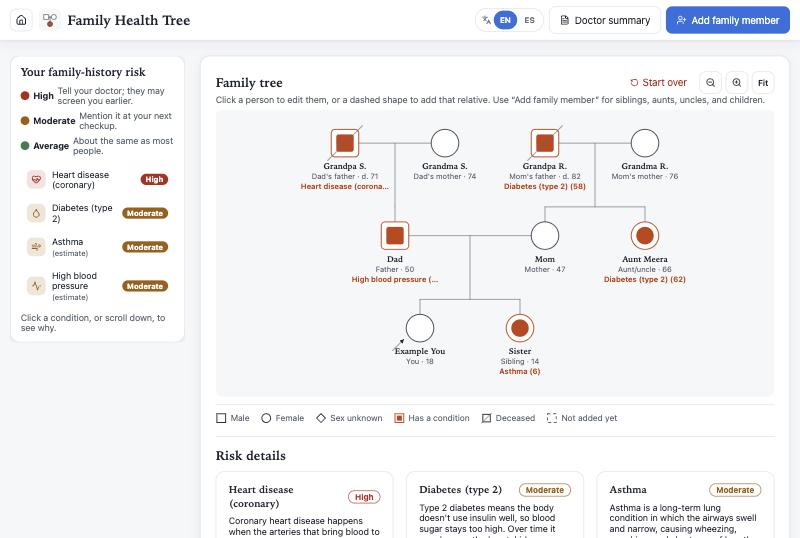
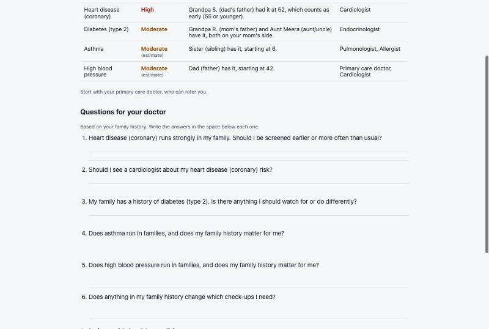
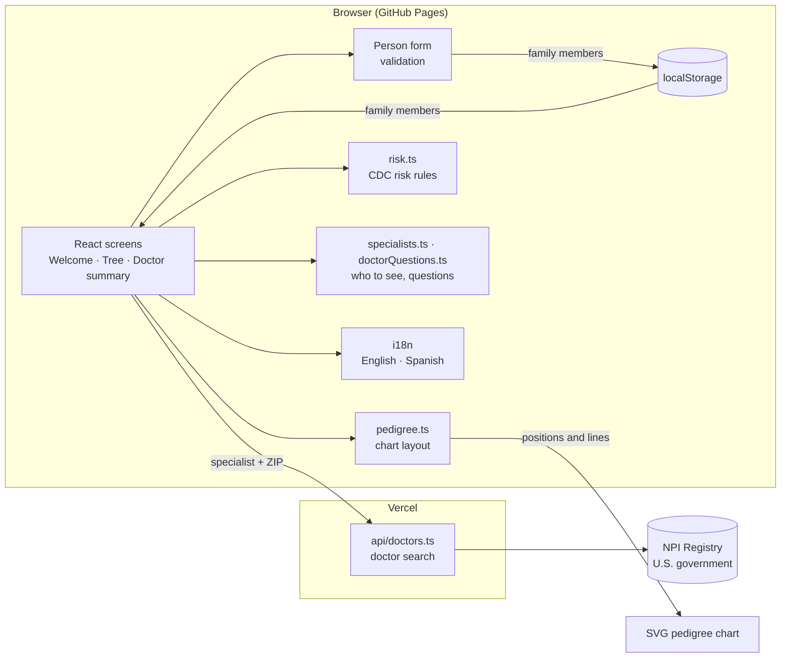

# Family Health Tree

**See which health conditions run in your family, and what to tell your doctor.**

**Live app:** https://maharanariddhi.github.io/family-health-tree/

**Source code:** kept in a private CS 124 course repository; the public `family-health-tree` repository holds the built site.

Doctors ask "Does this run in your family?" and most people can't answer, because the facts are scattered across relatives' memories. Family Health Tree lets you build your family tree as a medical pedigree chart, record the conditions your relatives have had and when they started, and see a family-history risk level for each condition, based on criteria published by the CDC. Then it helps you act on it: which kind of specialist to see, real doctors near you, and a printable summary with questions to bring to your appointment. It records and explains; it does not diagnose or give medical advice.


## Features

- **Pedigree chart.** The family is drawn the way genetic counselors draw it: squares for males, circles for females, a solid center for anyone with a condition, a slash for a relative who has died, and an arrow for you. Dad's side is on the left, mom's on the right, with great-grandparents above and cousins below their parents. Zoom in, zoom out, or fit the whole family to the screen.
- **Family-history risk levels.** Each condition gets a **High**, **Moderate**, or **Average** level, in red, yellow, and green, with a plain-language reason ("Grandpa S. had it at 52, which counts as early"). The risk list stays in view in a sidebar; clicking a condition highlights the relatives who have it.
- **What each disease is.** Every risk card explains the condition briefly and links to CDC.gov.
- **Who to see.** Each risk card names the kind of specialist who treats it, such as a cardiologist for heart disease, and suggests a genetic counselor when a cancer runs strongly in the family.
- **Find nearby doctors.** Type a ZIP code to see up to five nearby specialists of that kind, with address, map link, and phone number, from the U.S. government's public directory of licensed clinicians.
- **Doctor summary.** A one-page summary of risk levels, who to see, relatives with conditions, and **questions for your doctor** generated from your risks, with space to write the answers. It prints or saves as a PDF.
- **English and Spanish.** Switch languages on the welcome page or in the app bar; the doctor summary can be printed in English for the doctor.
- **Any condition.** Pick from common conditions or type your own.
- **Private by design.** Your family stays in your own browser. Only the doctor search sends anything out: the kind of specialist and a ZIP code.
- **Start over** erases the tree after asking, for trying a different family.
- **Works on phones.** On an iPhone, open the link in Safari and choose Share → Add to Home Screen to install it like an app.

| The tree page | Who to see and nearby doctors | Questions for your doctor |
|---|---|---|
|  |  |  |

*Screenshots use a made-up example family. The nearby doctors come from the public NPI Registry.*

## How the risk levels work

The levels follow the CDC's family history risk stratification criteria (Scheuner et al., as published in [*Preventing Chronic Disease*, January 2010](https://www.cdc.gov/pcd/issues/2010/Jan/08_0221a.htm)). Those criteria look at **who** has a condition (parents, siblings, and children count more than grandparents, aunts, and uncles), **which side** of the family, **how many** relatives, and whether it started **early** (for example, type 2 diabetes at 50 or younger, or heart disease at 55 or younger in men).

| Level | Example of what sets it |
|---|---|
| High | A parent or sibling had it early, or two or more parents or siblings have it |
| Moderate | One parent or sibling had it later in life, or two grandparents, aunts, or uncles on the same side have it |
| Average | No close relatives have it, or only one more distant relative |

The criteria name eight conditions: coronary heart disease, stroke, type 2 diabetes, and colon, prostate, breast, ovarian, and endometrial cancer. Other conditions get a level from the same family-pattern rules, without the early-onset rules, and are labeled **estimate**. Great-grandparents and cousins appear in the chart but don't change the levels, as in the criteria.

## Architecture



The app is a static single-page app; the family never leaves the browser. One small server function on Vercel handles the doctor search, because the NPI Registry doesn't accept requests from web pages. The chart layout, risk rules, questions, validation, and storage are plain TypeScript functions, kept separate from the React components so each can be tested on its own. All text lives in one English and one Spanish file; risk explanations and form errors are stored as facts and worded in the chosen language.

| Part | File |
|---|---|
| Data types (family member, condition, relationship) | `src/types.ts` |
| Relationships and form validation | `src/family.ts` |
| Pedigree layout: places each generation, couple, and sibling group without overlaps | `src/pedigree.ts` |
| Family-history risk levels | `src/risk.ts` |
| Specialists for each condition, and questions for the doctor | `src/specialists.ts`, `src/doctorQuestions.ts` |
| Disease descriptions and CDC links | `src/conditionInfo.ts` |
| Nearby doctor search (server) | `server/doctors.ts`, deployed as `api/doctors.ts` |
| Calling the doctor search from the app | `src/doctorSearch.ts` |
| English and Spanish text | `src/i18n/` |
| Saving and loading | `src/storage.ts` |
| Screens and components | `src/App.tsx`, `src/components/` |

## Key decisions

- **Risk levels, not percentages.** A real percentage chance depends on age, lifestyle, genetics, and disease-specific models, so a number computed from a family tree alone would be misleading. The app uses published CDC criteria instead and says what each level means for a doctor's visit.
- **Questions, never advice.** The doctor summary suggests questions to ask, not what to do; the doctor decides.
- **A pedigree chart instead of a simple list.** It's the standard format in genetic counseling, so the chart is familiar to a doctor. That meant writing a custom layout algorithm rather than using a charting library.
- **No accounts, and the family stays in the browser.** Family health history is sensitive. The only data that leaves the device is a specialist type and ZIP code for the doctor search.
- **A ZIP code instead of location access.** It's more private and works on every device.
- **Built from feedback.** A classmate couldn't find the risk results, which led to the risk sidebar that stays in view; a group critique led to the specialists and nearby-doctor features.

## Tech stack

React 19 · TypeScript · Vite · SVG · Vitest · Lucide icons · Vercel (doctor search) · GitHub Pages

## Run it locally

Requires [Node.js](https://nodejs.org) (LTS).

```bash
npm install
```

```bash
npm run dev
```

Then open the address it prints (usually http://localhost:5173). The doctor search runs inside the local dev server, so Find nearby works locally too.

## Test

```bash
npm test
```

60 tests cover the chart layout (placement and no overlaps), each CDC risk rule, specialists and doctor questions in both languages, the doctor search (with fake directory answers), form validation, disease descriptions, and saving, loading, and erasing, including recovering from corrupted saved data.

## Deploy

The site:

```bash
npm run deploy
```

Builds the site and publishes it to the public repository `maharanariddhi/family-health-tree`, which GitHub Pages serves at https://maharanariddhi.github.io/family-health-tree/.

The doctor search server:

```bash
npx vercel deploy --prod
```

It's served at https://family-health-tree-api.vercel.app and only answers the app's own website.

## What's next

- A phone layout with a bottom tab bar (Tree, Risks, Summary).
- A short guide for first-time users.
- More people trying it and giving feedback, and a review of the Spanish by a native speaker.

Built by Riddhi for CS 124 at the University of Illinois, working with Claude Code.
