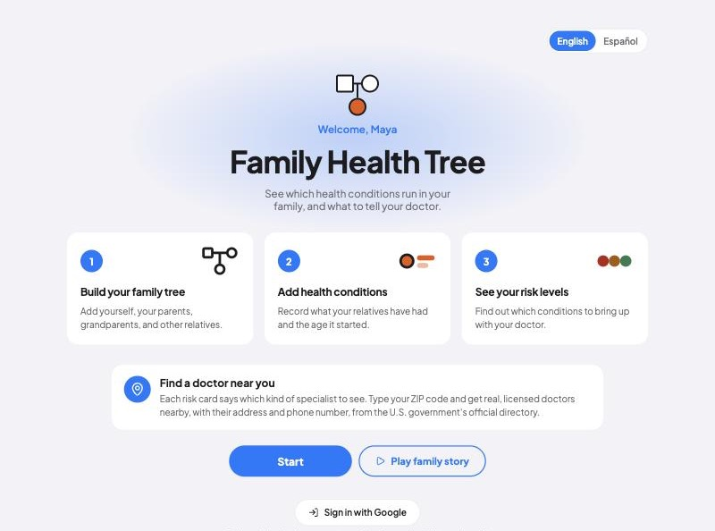
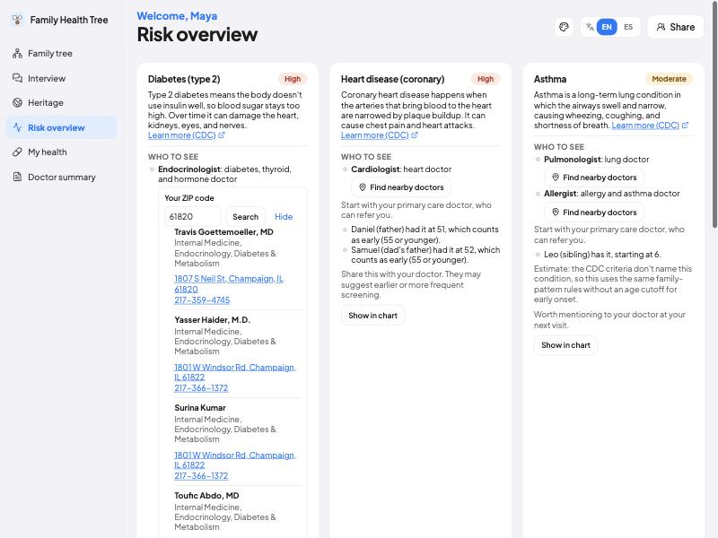
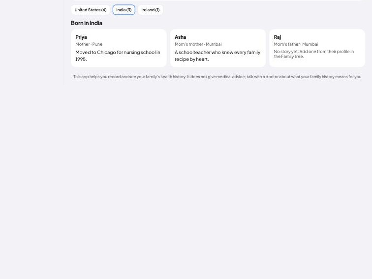
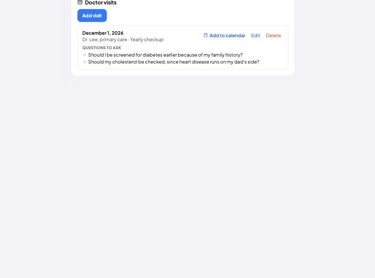
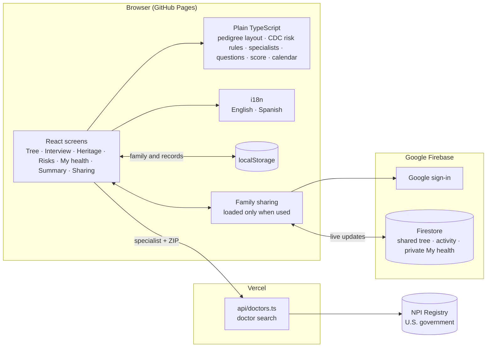

# Family Health Tree

**See which health conditions run in your family, and what to tell your doctor.**

**Live app:** https://maharanariddhi.github.io/family-health-tree/

**Source code:** kept in a private CS 124 course repository; the public `family-health-tree` repository holds the built site.

Doctors ask "Does this run in your family?" and most people can't answer, because the facts are scattered across relatives' memories. Family Health Tree lets you build your family tree as a medical pedigree chart, record the conditions your relatives have had and when they started, and see a family-history risk level for each condition, based on criteria published by the CDC. Then it helps you act on it: which kind of specialist to see, real doctors near you, your own health record and doctor visits, and a printable summary with questions to bring to your appointment. You can build the tree together with relatives, and keep their stories, birthplaces, and photos alongside their health. It records and explains; it does not diagnose or give medical advice.



## Features

### Your family's health

- **Pedigree chart.** The family is drawn the way genetic counselors draw it: squares for males, circles for females, a solid center for anyone with a condition, a slash for a relative who has died, and an arrow for you. Dad's side is on the left, mom's on the right, with great-grandparents above and cousins below their parents. Zoom in, zoom out, fit the whole family to the screen, or **find a person** by name.
- **Photos and person icons.** Give anyone a photo (cropped and shrunk on your device) or an emoji person icon in one of five skin tones. It shows inside their shape in the chart, and a condition moves to a small badge in the corner.
- **Family Interview.** An Interview tab walks through Mom, Dad, and all four grandparents one question at a time (name, living, age, conditions), for filling in the tree while talking with a relative.
- **Notes** on each person and each condition, marked with a note icon in the chart.
- **Any condition.** Pick from common conditions or type your own.

### Understanding the risk

- **Family-history risk levels.** Each condition gets a **High**, **Moderate**, or **Average** level, in red, yellow, and green, with a plain-language reason ("Grandpa S. had it at 52, which counts as early"). Clicking a condition highlights the relatives who have it.
- **What each disease is,** with a link to the official CDC or NIH page.
- **Who to see.** Each risk names the kind of specialist who treats it, such as a cardiologist for heart disease, and suggests a genetic counselor when a cancer runs strongly in the family.
- **Find a doctor nearby.** Type a ZIP code to see up to five nearby specialists of that kind, with address, map link, and phone number, from the U.S. government's public directory of licensed clinicians. A short guide shows first-time users how, and a clear message explains a mistyped ZIP code or an area with no matches.

### Your own health

- **My health.** Your medications (dose and how often) and allergies (and the reaction). It stays private to you, even when the family tree is shared.
- **Doctor visits.** Log each visit with the doctor, the reason, questions to ask (suggested from your family's risks), notes, and next steps.
- **Reminders.** "Add to calendar" saves a visit to Apple, Google, or Outlook calendar, and a **Coming up** card lists visits in the next 60 days.
- **Doctor summary.** One printable page with risk levels, who to see, relatives with conditions, your medications and allergies, and **questions for your doctor** with space for the answers. It prints or saves as a PDF.

### Your family's story

- **Heritage map.** Record where each relative was born and a few lines of their story; a world map pins every birthplace.
- **Family story slideshow.** "Play family story" on the home screen presents each generation, with photos, birthplaces, and stories.

### Building it together

- **Family sharing.** Sign in with Google (optional) and invite relatives with a link. Everyone sees the same tree, and changes show up for everyone within seconds. Only people you invite can see it.
- **Family activity.** A feed on the tree page shows who changed what ("Mom added Diabetes (type 2) to Grandma · just now"), and green dots show who has the app open.

### Coming back to it

- **Grow your tree.** A family history score and a "Next:" suggestion for what to add, plus 12 achievements that pop up as you earn them.
- **Backup and restore.** Download the whole family as a file and load it back on any device.
- **Start over** erases the tree after asking.

### Made for everyone

- **English and Spanish.** Switch anywhere; the doctor summary can be printed in English for the doctor.
- **Clean, app-like design** in light and dark mode, with the Plus Jakarta Sans font and seven theme colors to choose from.
- **Works on phones,** with a tab bar along the bottom. On an iPhone, open the link in Safari and choose Share → Add to Home Screen to install it like an app.

| The tree page | Who to see and nearby doctors | Doctor summary |
|---|---|---|
|  |  |  |

| Heritage map | My health |
|---|---|
|  |  |

*Screenshots use a made-up example family. The nearby doctors come from the public NPI Registry.*

## How the risk levels work

The levels follow the CDC's family history risk stratification criteria (Scheuner et al., as published in [*Preventing Chronic Disease*, January 2010](https://www.cdc.gov/pcd/issues/2010/Jan/08_0221a.htm)). Those criteria look at **who** has a condition (parents, siblings, and children count more than grandparents, aunts, and uncles), **which side** of the family, **how many** relatives, and whether it started **early** (for example, type 2 diabetes at 50 or younger, or heart disease at 55 or younger in men).

| Level | Example of what sets it |
|---|---|
| High | A parent or sibling had it early, or two or more parents or siblings have it |
| Moderate | One parent or sibling had it later in life, or two grandparents, aunts, or uncles on the same side have it |
| Average | No close relatives have it, or only one more distant relative |

The criteria name eight conditions: coronary heart disease, stroke, type 2 diabetes, and colon, prostate, breast, ovarian, and endometrial cancer. Other conditions get a level from the same family-pattern rules, without the early-onset rules, and are labeled **estimate**. Great-grandparents and cousins appear in the chart but don't change the levels, as in the criteria.

## Architecture



The app is a static single-page app that works entirely in the browser; without signing in, the family never leaves the device. One small server function on Vercel handles the doctor search, because the NPI Registry doesn't accept requests from web pages. Family sharing uses Firebase: Google sign-in, and a Firestore database that sends every change to everyone in the family live. Its code is downloaded only by people who use sharing, and `firestore.rules` decides who can read and write what (only invited family can see a tree; each person's My health record is readable only by them). The chart layout, risk rules, questions, score, and storage are plain TypeScript functions, kept separate from the React components so each can be tested on its own. All text lives in one English and one Spanish file.

| Part | File |
|---|---|
| Data types (family member, condition, health record) | `src/types.ts` |
| Relationships and form validation | `src/family.ts` |
| Pedigree layout: places each generation, couple, and sibling group without overlaps | `src/pedigree.ts` |
| Family-history risk levels | `src/risk.ts` |
| Specialists for each condition, and questions for the doctor | `src/specialists.ts`, `src/doctorQuestions.ts` |
| Disease descriptions and CDC/NIH links | `src/conditionInfo.ts` |
| Nearby doctor search (server, and calling it from the app) | `server/doctors.ts` (deployed as `api/doctors.ts`), `src/doctorSearch.ts` |
| My health, doctor visits, and calendar files | `src/healthRecord.ts`, `src/calendar.ts` |
| Interview, heritage, slideshow, photos, and person icons | `src/interview.ts`, `src/heritage.ts`, `src/slideshow.ts`, `src/photo.ts`, `src/avatar.ts` |
| Family history score and achievements | `src/progress.ts` |
| Family sharing: invite links and change tracking, Firebase, and the sync hook | `src/sharing.ts`, `src/cloud/`, `firestore.rules` |
| English and Spanish text | `src/i18n/` |
| Saving, loading, and backups | `src/storage.ts` |
| Screens and components | `src/App.tsx`, `src/components/` |
| Styles: shared design tokens, then one file per part of the app | `src/styles/` |

## Key decisions

- **Risk levels, not percentages.** A real percentage chance depends on age, lifestyle, genetics, and disease-specific models, so a number computed from a family tree alone would be misleading. The app uses published CDC criteria instead and says what each level means for a doctor's visit.
- **Questions, never advice.** The doctor summary suggests questions to ask, not what to do; the doctor decides.
- **A pedigree chart instead of a simple list.** It's the standard format in genetic counseling, so the chart is familiar to a doctor. That meant writing a custom layout algorithm rather than using a charting library.
- **Accounts are optional.** Family health history is sensitive, so the app works fully without signing in, and then the family stays in the browser (only a specialist type and ZIP code leave the device, for the doctor search). Signing in is only for sharing with relatives, who join by an invite link that can't be guessed.
- **My health is never shared.** In a shared family, everyone edits the same tree, but each person's medications, allergies, and visits stay in a private space only they can read.
- **A ZIP code instead of location access.** It's more private and works on every device.
- **Built from feedback.** A classmate couldn't find the risk results, which led to the risk sidebar that stays in view; a group critique led to the specialists and nearby-doctor features; a classmate's app (Lock In) inspired the score, reminders, and family sharing that give people a reason to come back.

## Tech stack

React 19 · TypeScript · Vite · SVG · d3-geo (heritage map) · Firebase Auth and Firestore (family sharing) · Vitest · Lucide icons · Vercel (doctor search) · GitHub Pages

## Run it locally

Requires [Node.js](https://nodejs.org) (LTS).

```bash
npm install
```

```bash
npm run dev
```

Then open the address it prints (usually http://localhost:5173). The doctor search runs inside the local dev server, so Find nearby works locally too.

Family sharing needs a Firebase project. Put its web settings in a `.env.local` file (kept out of git) as `VITE_FIREBASE_API_KEY`, `VITE_FIREBASE_AUTH_DOMAIN`, `VITE_FIREBASE_PROJECT_ID`, `VITE_FIREBASE_STORAGE_BUCKET`, `VITE_FIREBASE_MESSAGING_SENDER_ID`, and `VITE_FIREBASE_APP_ID`, and publish `firestore.rules` in the Firebase console. Without the file, everything else works and sharing is simply turned off.

## Test

```bash
npm test
```

187 tests in 31 files cover the chart layout (placement and no overlaps), each CDC risk rule, specialists and doctor questions in both languages, the doctor search (with fake directory answers) and its messages, form validation, the interview, heritage, slideshow, photos and person icons, the score and achievements, calendar files, family sharing (invite links, what changed, the activity feed, who's online), the main screens, and saving, loading, backups, and erasing, including recovering from corrupted saved data.

## Deploy

The site:

```bash
npm run deploy
```

Builds the site and publishes it to the public repository `maharanariddhi/family-health-tree`, which GitHub Pages serves at https://maharanariddhi.github.io/family-health-tree/.

The doctor search server:

```bash
npx vercel deploy --prod
```

It's served at https://family-health-tree-api.vercel.app and only answers the app's own website.

## What's next

- **Ask a relative:** send a relative a question by link ("When did Grandpa's heart problem start?"); they answer without an account, and the answer lands on that person in your tree.
- Telling a ZIP code that doesn't exist apart from an area with no matching doctors.
- More classmates trying it, and a review of the Spanish by a native speaker.

Built by Riddhi for CS 124 at the University of Illinois, working with Claude Code.
