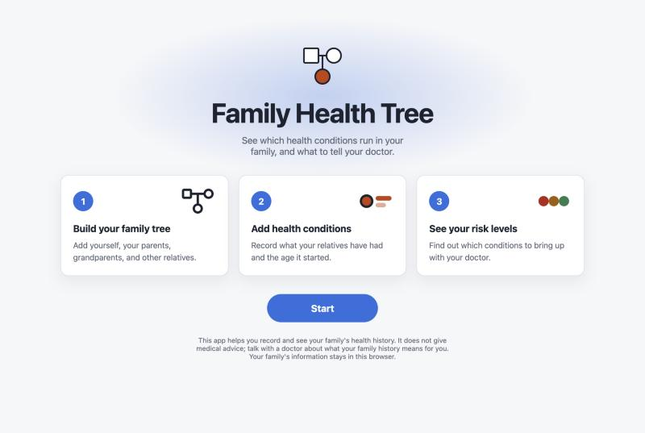
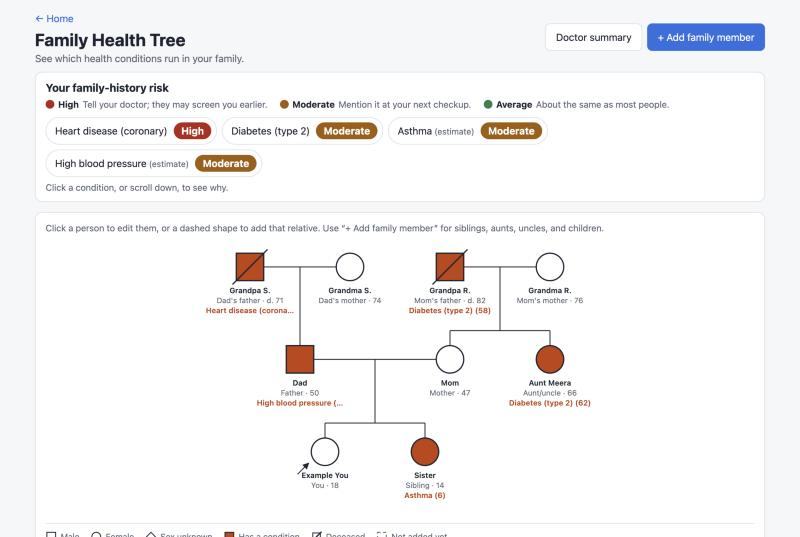
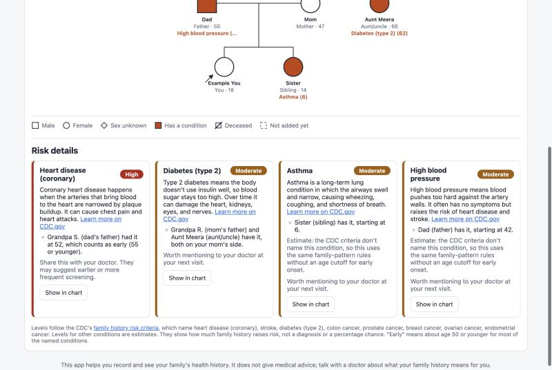
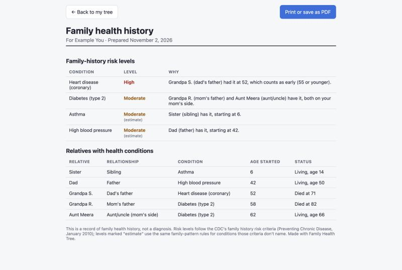
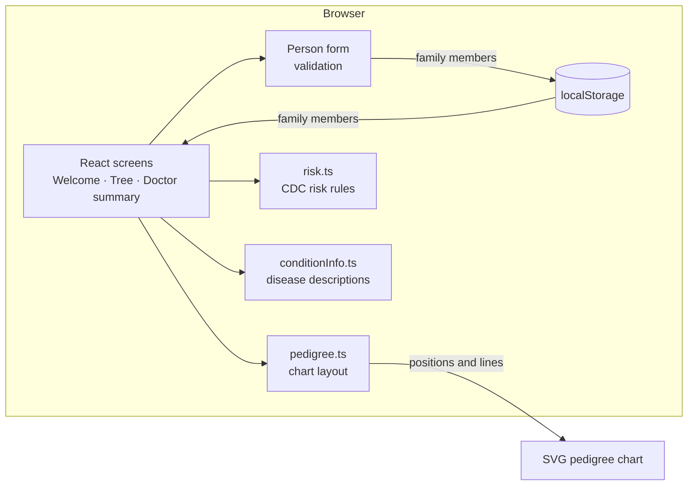

# Family Health Tree

**See which health conditions run in your family, and what to tell your doctor.**

**Live app:** https://maharanariddhi.github.io/family-health-tree/

**Source code:** kept in a private CS 124 course repository; the public `family-health-tree` repository holds the built site.

Doctors ask "Does this run in your family?" and most people can't answer, because the facts are scattered across relatives' memories. Family Health Tree lets you build your family tree as a medical pedigree chart, record the conditions your relatives have had and when they started, and see a family-history risk level for each condition, based on criteria published by the CDC. It records and explains; it does not diagnose or give medical advice.



## Features

- **Pedigree chart.** The family is drawn the way genetic counselors draw it: squares for males, circles for females, a filled shape for anyone with a condition, a slash for a relative who has died, and an arrow for you. Dad's side is on the left, mom's on the right, with great-grandparents above and cousins below their parents.
- **Family-history risk levels.** Each condition gets a **High**, **Moderate**, or **Average** level, in red, yellow, and green, with a plain-language reason ("Grandpa S. had it at 52, which counts as early") and a next step for talking to a doctor.
- **Disease explanations.** Each risk card says briefly what the condition is and links to CDC.gov to learn more.
- **Any condition.** Pick from common conditions or type your own.
- **Doctor summary.** A one-page summary of risk levels and affected relatives that prints or saves as a PDF to bring to an appointment.
- **Private by design.** Everything stays in your own browser. Nothing is sent to a server.
- **English and Spanish.** Switch languages on the welcome page or at the top of the app; the doctor summary can be printed in English for the doctor.
- **Works on phones.** On an iPhone, open the link in Safari and choose Share → Add to Home Screen to install it like an app.

| Pedigree chart and risk summary | Risk details | Doctor summary |
|---|---|---|
|  |  |  |

*Screenshots use a made-up example family.*

## How the risk levels work

The levels follow the CDC's family history risk stratification criteria (Scheuner et al., as published in [*Preventing Chronic Disease*, January 2010](https://www.cdc.gov/pcd/issues/2010/Jan/08_0221a.htm)). Those criteria look at **who** has a condition (parents, siblings, and children count more than grandparents, aunts, and uncles), **which side** of the family, **how many** relatives, and whether it started **early** (for example, type 2 diabetes at 50 or younger, or heart disease at 55 or younger in men).

| Level | Example of what sets it |
|---|---|
| High | A parent or sibling had it early, or two or more parents or siblings have it |
| Moderate | One parent or sibling had it later in life, or two grandparents, aunts, or uncles on the same side have it |
| Average | No close relatives have it, or only one more distant relative |

The criteria name eight conditions: coronary heart disease, stroke, type 2 diabetes, and colon, prostate, breast, ovarian, and endometrial cancer. Other conditions get a level from the same family-pattern rules, without the early-onset rules, and are labeled **estimate**. Great-grandparents and cousins appear in the chart but don't change the levels, as in the criteria.

## Architecture



The app is a static single-page app with no server. The chart layout, risk rules, validation, and storage are plain TypeScript functions, kept separate from the React components so each can be tested on its own.

| Part | File |
|---|---|
| Data types (family member, condition, relationship) | `src/types.ts` |
| Relationships and form validation | `src/family.ts` |
| Pedigree layout: places each generation, couple, and sibling group without overlaps | `src/pedigree.ts` |
| Family-history risk levels | `src/risk.ts` |
| Disease descriptions and CDC links | `src/conditionInfo.ts` |
| Saving and loading | `src/storage.ts` |
| Screens and components | `src/App.tsx`, `src/components/` |

## Key decisions

- **Risk levels, not percentages.** A real percentage chance depends on age, lifestyle, genetics, and disease-specific models, so a number computed from a family tree alone would be misleading. The app uses published CDC criteria instead and says what each level means for a doctor's visit.
- **A pedigree chart instead of a simple list.** It's the standard format in genetic counseling, so the chart is familiar to a doctor. That meant writing a custom layout algorithm rather than using a charting library.
- **No server, no accounts.** Family health history is sensitive. Keeping it in the browser means nothing leaves the user's device.
- **The browser's own print window for the PDF.** It works on phones and laptops without adding a PDF library.

## Tech stack

React 19 · TypeScript · Vite · SVG · Vitest · GitHub Pages

## Run it locally

Requires [Node.js](https://nodejs.org) (LTS).

```bash
npm install
```

```bash
npm run dev
```

Then open the address it prints (usually http://localhost:5173).

## Test

```bash
npm test
```

The tests cover the chart layout (placement and no overlaps), each CDC risk rule, form validation, disease descriptions, and saving and loading, including recovering from corrupted saved data.

## Deploy

```bash
npm run deploy
```

Builds the site and publishes it to the public repository `maharanariddhi/family-health-tree`, which GitHub Pages serves at https://maharanariddhi.github.io/family-health-tree/.

## What's next

- More languages, and a review of the Spanish by a native speaker.
- More people trying it and giving feedback.

Built by Riddhi for CS 124 at the University of Illinois, working with Claude Code.
